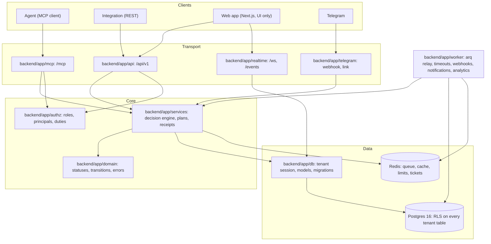
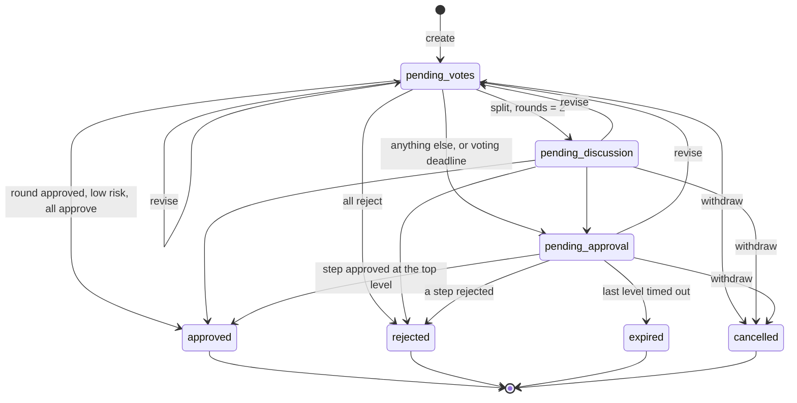
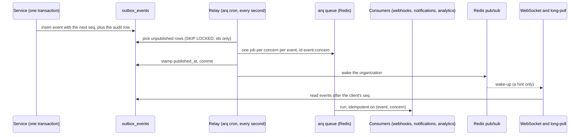

# Architecture

Three interfaces (MCP, REST, the web app) share one service layer, and Postgres enforces tenancy underneath all of it. This file is
checked against the code by `scripts/check_docs.sh`: the state diagram must equal `backend/app/domain/transitions.py`, and every path
named here must exist.

## Layers

Imports point down. A handler parses input, resolves the principal, calls one service and maps the result; business rules live in
`services/` and `domain/`, never in a handler.



| Folder | Owns |
|---|---|
| `backend/app/api/`, `backend/app/mcp/`, `backend/app/realtime/`, `backend/app/telegram/` | transport: input parsing, principal resolution, status codes, DTOs |
| `backend/app/services/` | the decision engine and every other rule; no transport code |
| `backend/app/authz/` | the role and action matrix, principals, separation-of-duties predicates (no I/O) |
| `backend/app/domain/` | statuses, the transition table, errors, hashing, receipt signing |
| `backend/app/db/` | models, migrations, the tenant session that sets the RLS context |
| `backend/app/ports/`, `backend/app/adapters/` | outside systems behind interfaces: clock, notifier, analytics, cache, pub/sub |
| `backend/app/worker/` | the arq worker: relay, timeout sweep, webhook delivery, notifications, analytics |
| `frontend/src/` | the web app; talks to REST and the realtime channel only |

## Tenancy

Every request resolves one organization from its credential (the token's, or the session's selected one re-checked against
memberships). `backend/app/db/session.py` opens a transaction and sets `app.organization_id`; every tenant table has a forced
row-level-security policy on it, and the runtime role `app_rt` is neither owner nor `BYPASSRLS` (the API refuses to start otherwise,
`backend/app/db/guard.py`). Cross-tenant ids answer 404, the same as ids that exist nowhere. Migrations run as a separate owner
role (`scripts/migrate.sh`). The worker scans for due work as `app_worker` (ids only) and does the work in the item's own tenant
session as `app_rt`.

## Decision state machine

A request is `pending_votes` until its round closes, then is auto-approved, rejected, discussed (policy `rounds = 2`) or sent to
humans. A revise returns any open request to `pending_votes` with a new version; a withdraw cancels it.



Only effective risk `low` lets unanimity skip humans (agreement is not proof). Humans decide one level at a time: `medium` needs
level 1, `high` all levels; a step times out to a stand-in at the next level, and the last level's timeout expires the request. A
decision is valid only for the version it was made on. On `approved` the engine signs a receipt (HMAC-SHA256 over request id,
version, content hash, approval time and approvers); verifying recomputes from the live request, so any later change breaks it.

Every state change locks the request row or uses a conditional update, and writes its audit row and outbox event in the same
transaction. `backend/app/domain/transitions.py` holds the table, and a database trigger mirrors it.

## Event flow

An event is committed with the change that caused it, so a crash can delay delivery and never lose it. `seq` is per organization
and assigned under a counter-row lock, so seq order equals commit order.



Consumers are idempotent because delivery is at-least-once: webhooks send signed bodies with backoff and a dead-letter state,
notifications reach Telegram only for Pro organizations, analytics emit four event kinds with ids and enums only. Realtime reads the
outbox directly (see [REALTIME.md](REALTIME.md)), so a lost wake-up or a Redis outage delays a client by seconds and loses nothing.
Realtime frames pass the per-type allow-list in `backend/app/realtime/projection.py`, which also enforces round-1 blindness.

## MCP flow

```mermaid
sequenceDiagram
    participant A as Agent
    participant M as /mcp (Streamable HTTP, stateless)
    participant V as BearerVerifier
    participant T as Tool
    participant S as Service
    participant D as Postgres
    A->>M: POST tools/call with Authorization: Bearer aop_...
    M->>V: verify the token (re-run on every request)
    V->>D: resolve token to principal and organization
    V-->>M: principal, or one 401 for every failure
    M->>T: call, with the principal in context
    T->>S: write counts one rate-limit unit; session_label picks the quorum seat
    S->>D: tenant session, RLS context, conditional updates
    S-->>T: result, or a domain error
    T-->>A: structured output, or "code: what to do next"
```

Tools never read headers; the principal comes from the verifier. Tools an agent may not use (`decide_approval_step`) are left out of
`tools/list` for agent tokens and refused by name. All strings in outputs are agents' own data and are never echoed as instructions.

## Plans and flags

`features.is_enabled(organization, flag)` is the single decision point: the plan's flags combined with per-organization overrides,
cached in Redis for 60 s with an explicit invalidation on every write that can change the answer (`backend/app/services/cache.py`).
Gated REST routes use the `gate(flag)` dependency and gated MCP tools the `gated(flag)` decorator; limits (requests per month,
quorum, rounds, levels) are checked when a request is created or a policy saved, and never clamped silently.

## Deployment

`docker compose` runs Postgres and Redis locally and builds the production images (profile `prod`: `api`, `worker`, `web`; the worker is the
API image started with `arq app.worker.settings.WorkerSettings`). CI runs `scripts/gate.sh`, whose images step starts all three, checks
they run as non-root and that the worker can log in as `app_worker`. A green run on `main` triggers `.github/workflows/deploy.yml`, which
runs `railway up` for the API (migrating first, as the owner role, in Railway's pre-deploy step), then the worker, then the web app.
Migrations are additive so an older build keeps working while a newer one rolls out. The worker's database login is `app_worker`, a
role with column-limited reads that is `NOLOGIN` until `scripts/migrate.sh` runs with `APP_WORKER_PASSWORD`.

> **In flight on other branches (from the spec, verify at merge).** File storage behind a `FileStorage` port with a local and an
> S3-compatible adapter, and Postgres full-text search behind a `Search` port (slices S32, S33). The web app screens beyond sign-in
> (inbox, decision list and detail, agents, teams, members, policies, webhooks, plan and analytics; slices S39 to S44), the realtime
> client with its connection banner (S45) and the public landing page (S46, S47) are being built; this file describes the backend and
> the shell that exist on this base.
